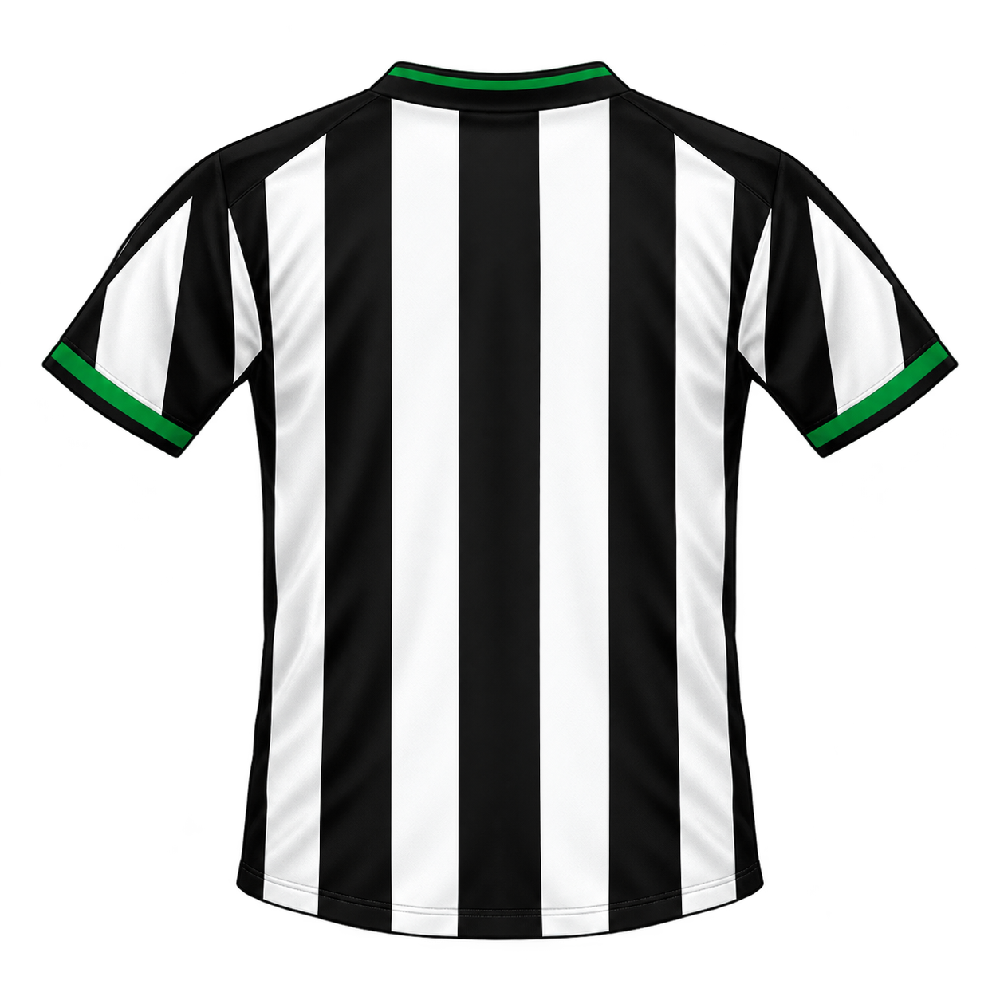
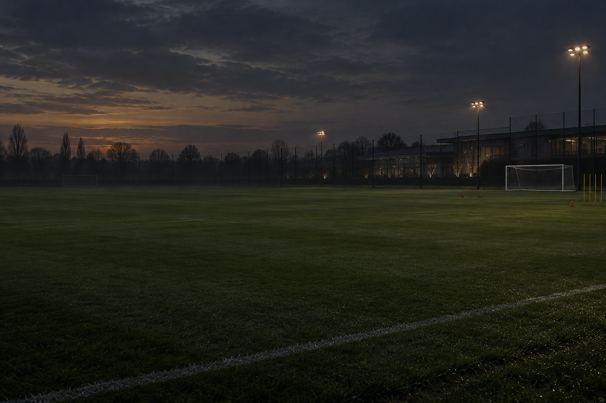

# Centro de Desenvolvimento — projeto da tela

Documento de referência para construir no FM06 uma Central de Desenvolvimento em que o treinador
adjunto, os treinadores e os olheiros acompanham os jovens do clube, apresentam avaliações
imperfeitas, sugerem treino e posição e explicam o caminho até o time principal.

Este documento descreve o que já foi comprovado, o desenho recomendado, as propriedades que ainda
precisam ser criadas no executável, os arquivos XML envolvidos e os recursos visuais preparados no
projeto. Nada desta pasta é instalado automaticamente no jogo.

## 1. Estado atual comprovado

Já funciona no jogo:

- o item `tcdv` — **Centro de Desenvolvimento** — em `data/sections.xml`;
- o vínculo de `tcdv` com `person_search_panel` em `data/screens/team.xml`;
- a visão `dsnv` — **Desenvolvimento** — em `person search list.xml`;
- as propriedades `Pest` e `Pesp`, que mostram a avaliação de habilidade e potencial da comissão;
- a propriedade/filtro `Pmcl`, que identifica jogadores de qualquer equipe do clube do humano;
- o filtro manual `Pmcl >= 20`, `Page <= 19` e “Incluir seus jogadores no resultado”.

O código atual dessas propriedades está em `src/fm06patch/centro.py`. A instalação dos XMLs e da
skin está em `scripts/aplicar_telas.py`. O diário de engenharia reversa está em
`docs/analise/T1.md`.

Problema atual: `person_search_panel` continua sendo uma busca global. Ao abrir a Central, o jogo
prepara/desenha milhares de jogadores antes de o usuário aplicar o filtro. O próximo passo técnico
mais importante é inserir o filtro antes da primeira montagem da lista ou substituir sua fonte de
dados por uma lista já limitada aos jogadores do clube.

## 2. Descobertas sobre as telas do FM06

### 2.1 Não existe um “relatório do olheiro” individual em XML

No perfil de um jogador externo existe a ação **Pedir Relatório Olheiro**, mas não foi encontrado um
painel individual independente chamado `player scout report.xml` ou equivalente. A pesquisa nos
arquivos do jogo e a navegação no FM06 mostraram que o relatório de observação é distribuído entre
notícias, propriedades da pessoa, lista de jogadores e perfil.

Portanto, não há uma página pronta que possa ser simplesmente copiada para `tcdv`.

### 2.2 A melhor base individual é `player training.xml`

Arquivo principal:

`C:\Games\Football Manager 2006\data\skins\aurora 2006\panels\player training.xml`

A tela foi conferida no jogo em **Toninho > Treino > Geral**. Ela já contém os controles mais úteis
para a futura página:

| ID | Classe/função existente | Uso na Central |
|---|---|---|
| `chmn` | seletor de treinador | selecionar/mostrar quem avaliou |
| `trpp` | plano de treino | treino atual e plano recomendado |
| `nwps` | treino de nova posição | posição sugerida/escolhida |
| `nwpr` | nível da nova posição | progresso de adaptação |
| `fitn` | condição física | disponibilidade para treinar/jogar |
| `happ` | satisfação | reação ao treino e ao uso |
| `cccm` | comentário do treinador | parecer textual principal |
| `trlv` | gráfico de níveis de treino | carga por categoria |
| `trpr` | gráfico de progresso | evolução ao longo dos meses |

Preservar esses IDs permite reaproveitar o controlador existente. Alterar somente a arrumação, os
títulos e as caixas no XML é muito menos arriscado que criar uma classe de painel do zero.

### 2.3 `non player team report.xml` é uma boa referência coletiva

Arquivo:

`C:\Games\Football Manager 2006\data\skins\aurora 2006\panels\non player team report.xml`

Ele possui:

- `desc`: parecer geral do adjunto;
- `trpi`: avaliação por setor;
- `trft`: escalação e nota dos jogadores;
- `pitc`: campo com o time recomendado.

Seu controlador pertence ao relatório de equipe acessado pelo perfil de um funcionário (`Ptrp`). Ele
não é uma substituição direta para `tcdv`, mas o leiaute e a lógica podem inspirar uma futura página
“Visão do Adjunto”.

### 2.4 Comparação Aurora e Turnstyle 3

Os arquivos `player training.xml` das duas skins têm a mesma estrutura e os mesmos IDs. A principal
diferença é visual: a Aurora usa mais `round_box`; a Turnstyle usa `group_box` e `subsection_box`.

A Aurora não contém imagens de estrelas. A Turnstyle 3 instalada possui:

`C:\Games\Football Manager 2006\data\skins\turnstyle3\graphics\stars\1star.png` até
`5star.png`, com 40 × 20 pixels.

Essas imagens servem como referência, mas não devem ser distribuídas com o mod sem antes verificar a
autorização do autor. O ideal é produzir um conjunto próprio para a skin Brasil 2026.

## 3. Arquitetura recomendada

### 3.1 Primeira tela: lista da Central

Manter `tcdv` como `person_search_panel` na primeira versão. A Central começa como uma lista rápida,
com uma linha por jovem e somente as informações necessárias para decidir quem merece atenção.

Colunas recomendadas:

1. situação;
2. nome;
3. idade;
4. posição atual;
5. equipe atual — principal, B, Sub-20 ou emprestado;
6. habilidade estimada;
7. potencial estimado;
8. fase de desenvolvimento;
9. posição sugerida;
10. treino recomendado;
11. minutos recentes;
12. tendência de evolução;
13. data da última avaliação.

As colunas longas não devem aparecer todas ao mesmo tempo em resoluções pequenas. Criar visões
separadas no menu **Ver**:

- **Resumo**: nome, idade, posição, Hab., Pot., fase e tendência;
- **Plano**: nome, posição sugerida, treino, equipe e minutos;
- **Comissão**: nome, avaliador, confiança, última avaliação e parecer curto;
- **Contrato**: nome, equipe, empréstimo, salário, vínculo e valor.

### 3.2 Segunda tela: relatório individual

Na primeira implementação, clicar no jogador pode continuar abrindo o perfil normal. A página
detalhada ficará em **Treino > Geral**, com `player training.xml` reorganizado e renomeado como
**Relatório de Desenvolvimento**.

Composição sugerida:

```text
┌─────────────────────────────────────────────────────────────────────────┐
│ RELATÓRIO DE DESENVOLVIMENTO                  avaliador ▾  atualizado em │
├──────────────┬──────────────────────────┬───────────────────────────────┤
│ foto/escudo  │ nome, idade, posição     │ camisa de costas             │
│ ou silhueta  │ equipe e contrato        │ NOME                         │
│              │ Hab. ★★★☆☆ Pot. ★★★★☆   │  13                          │
├──────────────┴──────────────────────────┴───────────────────────────────┤
│ PARECER: “pode chegar ao time principal, mas precisa...”               │
├───────────────────────────────┬─────────────────────────────────────────┤
│ PLANO DOS PRÓXIMOS 90 DIAS    │ DIAGNÓSTICO                             │
│ posição / treino / minutos    │ pontos fortes / fracos / riscos        │
├───────────────────────────────┼─────────────────────────────────────────┤
│ níveis de treino              │ progresso mensal e marcos               │
└───────────────────────────────┴─────────────────────────────────────────┘
```

Uma central completa com lista e relatório lado a lado é possível, mas exige um novo controlador de
painel: `person_search_panel` não alimenta automaticamente widgets de detalhe com a linha selecionada.
Essa versão deve ficar para depois do MVP.

## 4. A camisa de costas

A camisa é um elemento forte porque transforma uma planilha em uma ficha de jogador. O protótipo do
Figueirense está em:



Ela foi criada sem patrocinador, escudo, nome e número. Isso é intencional.

### 4.1 O que deve ser fixo e o que deve ser dinâmico

Imagem-base:

- cores e padrão da camisa;
- gola e punhos;
- volume, dobras e sombra;
- transparência ao redor da peça.

Widgets/código sobre a imagem:

- nome curto do jogador;
- número atual;
- cor do nome e do número;
- eventual selo “Sub-20”, “Emprestado” ou “Time principal”.

Não gerar uma imagem diferente para cada jogador. Nome e número mudam durante o save e devem ser
desenhados pelo jogo.

### 4.2 Solução para todos os clubes

O projeto já gera a frente das camisas em `src/fm06patch/graficos.py`, função `kit_png`, usando cores,
modelo, fornecedor, patrocínio e escudo. A solução de produção é ampliar esse gerador:

1. adicionar `kit_back_png` ou um argumento `view="back"` em `kit_png`;
2. reaproveitar `BODY`, `SLEEVE`, `_pattern`, `_shading`, gola e punhos;
3. não desenhar escudo, fornecedor nem patrocinador;
4. gerar `<slug>_home_back.png`, `<slug>_away_back.png` e, quando houver, `third_back`;
5. criar novas chaves, por exemplo `graphics/pictures/team/<UID>/kits/home_back`;
6. fazer o painel pedir a camisa traseira do clube atual;
7. sobrepor nome e número em widgets separados.

O protótipo do Figueirense serve para acertar escala, área livre e aparência antes de automatizar o
gerador de todos os clubes.

### 4.3 Casos especiais

- goleiro: usar camisa de goleiro se houver; senão, usar a away;
- jogador emprestado: decidir se a ficha mostra a camisa do clube dono ou do clube atual — recomenda-se
  mostrar a atual e escrever “emprestado por ...” abaixo;
- sem número: mostrar `—` ou “Sub-20”, nunca inventar um número;
- nomes longos: reduzir tamanho da fonte, usar sobrenome/nome curto e limitar a uma linha;
- contraste: escolher automaticamente número branco ou preto pela luminância da área central da camisa.

## 5. Propriedades novas propostas

Os códigos abaixo não aparecem atualmente nos XMLs pesquisados. Antes de gravar o patch definitivo,
confirmar também que não colidem com códigos internos do executável.

| Código | Tipo | Significado | Onde aparece |
|---|---|---|---|
| `Pfas` | texto curto | fase do desenvolvimento | lista e relatório |
| `Ppso` | texto curto | posição sugerida | lista e plano |
| `Ptrg` | texto curto | treino recomendado | lista e plano |
| `Pava` | pessoa/texto | nome do avaliador | relatório |
| `Pcon`* | número/texto | confiança da avaliação | relatório |
| `Ppfo` | texto | principal ponto forte | diagnóstico |
| `Ppfr` | texto | principal ponto fraco | diagnóstico |
| `Psug` | texto longo | parecer da comissão | relatório |
| `Pevo` | número/texto | tendência de evolução | lista e gráfico |
| `Pmin`* | número/texto | minutos no período | lista e plano |
| `Ppra` | texto/data | próxima revisão | rodapé do relatório |
| `Pdno` | número/texto | número da camisa | sobreposição na camisa |

`Pcon` e `Pmin` já podem ter outros significados no FM06. Eles são nomes conceituais e provavelmente
deverão ser substituídos por códigos livres após a varredura completa.

O hook atual de `centro.py` retorna números por meio da variante usada pelo jogo. Para preencher essas
propriedades será necessário implementar também retorno de texto e, no caso do avaliador, guardar a
pessoa escolhida, não somente sua nota de julgamento.

## 6. Quem deve avaliar cada informação

Não usar sempre o funcionário de maior atributo para tudo. Isso deixaria a comissão sem personalidade.

| Informação | Fonte principal | Atributo relevante |
|---|---|---|
| habilidade atual | adjunto ou olheiro responsável | `Npja` |
| potencial | adjunto ou olheiro responsável | `Npjp` |
| treino recomendado | treinador responsável | categoria de treino + jovens |
| nova posição | adjunto/treinador | tática, julgamento e atributos do atleta |
| risco físico | fisioterapeuta/preparador | fisioterapia e condição |
| empréstimo/minutos | adjunto | julgamento, reputação e nível do elenco |

Guardar no cache da Central:

- ponteiro ou UID do avaliador de habilidade;
- ponteiro ou UID do avaliador de potencial;
- notas `Npja` e `Npjp`;
- clube do humano;
- data da última atualização;
- nível de confiança/erro por jogador.

Quando dois membros discordarem, isso pode aparecer como conteúdo, não como erro:

> “O adjunto vê potencial para o time principal; o olheiro é mais cauteloso.”

## 7. Como calcular as recomendações

### 7.1 Estrelas e confiança

Manter a filosofia já implementada: nota estimada pela comissão, com erro estável por jogador e erro
menor quanto melhor o avaliador.

Não mostrar CA ou PA reais. A Central deve mostrar opinião, não o banco de dados do jogo.

Escala visual sugerida: cinco estrelas com meios pontos. O valor interno 0–10 vira 0–5 estrelas:

`estrelas_visuais = nota_de_0_a_10 / 2`

Além das estrelas, mostrar confiança:

- baixa: relatório novo, avaliador fraco ou pouca observação;
- média: acompanhamento regular;
- alta: jogador do clube observado diariamente por funcionário competente.

### 7.2 Posição sugerida

Para cada posição possível:

1. calcular uma nota ponderada dos atributos importantes;
2. considerar pé preferido, altura, velocidade e familiaridade atual;
3. aplicar pequena incerteza de acordo com o avaliador;
4. penalizar mudanças que demorariam demais para a idade do jogador;
5. devolver posição principal e uma alternativa.

Não sugerir apenas a posição de maior nota. A tela deve explicar o motivo:

> “Tem passe e criatividade para atuar por dentro; falta velocidade para jogar aberto.”

### 7.3 Treino sugerido

Comparar o jogador com o perfil da posição sugerida e escolher uma ou duas lacunas treináveis. Evitar
recomendações absurdas ou genéricas.

Exemplos:

- zagueiro lento: aeróbico/velocidade e posicionamento;
- meia criativo fraco: força e resistência, sem abandonar controle de bola;
- atacante sem movimentação: ofensivo e tático;
- goleiro jovem: treino de goleiro, decisão e comunicação.

### 7.4 Minutos e caminho de carreira

Classificar o jogador em uma fase:

- **Formação**: ainda precisa de treino e Sub-20;
- **Transição**: treinar com o principal e jogar no B/Sub-20;
- **Pronto para minutos**: banco e copas/jogos menores;
- **Empréstimo recomendado**: precisa de nível competitivo e minutos;
- **Prioridade**: potencial alto e risco de estagnação/contrato;
- **Reavaliar**: relatório antigo ou comissão pouco confiável.

O parecer “pode virar titular em dois anos” deve comparar a avaliação do jovem com o nível dos
jogadores atuais da posição no time principal, não usar apenas idade e PA.

## 8. Elementos visuais preparados

Pasta do projeto:

`data/brasil/telas/centro_desenvolvimento/assets/`

### 8.1 Camisa traseira do Figueirense

- arquivo: `camisa-costas-figueirense-base.png`;
- tamanho-fonte: 1254 × 1254;
- fundo: transparente;
- uso: protótipo do bloco de identidade do jogador e referência para `kit_back_png`;
- não contém nome, número, escudo ou patrocinador.

### 8.2 Emblema da Central


- arquivo: `emblema-centro-desenvolvimento.png`;
- tamanho-fonte: 1254 × 1254;
- fundo: transparente;
- conceito: bola em crescimento, folhas e seta de evolução;
- uso recomendado: marca grande do cabeçalho, marca-d'água ou tela vazia;
- não usar diretamente como ícone de 20 × 20: há detalhes demais. Deve ser simplificado ou ganhar uma
  variante pequena própria antes de entrar no menu lateral.

### 8.3 Fundo do centro de treinamento



- arquivo: `fundo-centro-treinamento.png`;
- tamanho: 1536 × 1024;
- fundo opaco;
- uso: fundo exclusivo da Central, atrás de caixas semitransparentes;
- composição: campo de treino vazio ao anoitecer, com maior detalhe à direita e áreas calmas para texto.

Antes de instalar no jogo, gerar versões otimizadas para as resoluções realmente suportadas pela skin
(por exemplo 1024 × 768 e 1280 × 800) e conferir consumo de memória e legibilidade.

## 9. Ideias adicionais que valorizam a tela

### Essenciais

- data da última avaliação e próxima revisão;
- nome, cargo e qualidade do avaliador;
- confiança do relatório;
- plano de 90 dias;
- meta de minutos;
- fase atual do desenvolvimento;
- pontos fortes e fracos explicados em linguagem natural;
- alerta de contrato para promessa perto do fim do vínculo;
- histórico de evolução sem revelar CA/PA real.

### Boas expansões

- comparação com o titular da mesma posição;
- mapa de posições com “natural”, “adaptável” e “não recomendado”;
- divergência entre adjunto e olheiro;
- recomendação de empréstimo com nível de liga desejado;
- aviso de excesso de carga ou risco físico;
- marco “estreia”, “primeiro gol”, “convocado para o principal”;
- selo para jogador da fornada anual;
- pequeno retrato do avaliador ao lado do parecer;
- estado vazio elegante quando o clube não possui jovens elegíveis;
- ordenação por “precisa de decisão”, não apenas por potencial.

Evitar transformar a tela em um editor: números ocultos exatos, PA real, personalidade oculta e
probabilidades perfeitas quebrariam a função narrativa da comissão.

## 10. Caminho de implementação

### Etapa A — protótipo visual seguro

1. copiar `player training.xml` da Aurora para a skin Brasil 2026;
2. preservar todos os IDs reconhecidos pelo controlador;
3. reorganizar título, caixas e gráficos;
4. inserir temporariamente a camisa traseira e o fundo;
5. testar em 1024 × 768 e na resolução usada pelo projeto;
6. conferir no jogo jogadores com e sem foto, goleiro, emprestado e nome longo.

Nesta etapa, widgets novos podem mostrar textos fixos de protótipo. O objetivo é validar espaço e
legibilidade, não a lógica final.

### Etapa B — abrir a Central já filtrada

1. localizar o momento em que o objeto `person_search_panel` de `tcdv` recebe sua lista;
2. identificar `tcdv` pelo ID da seção para não alterar a busca normal de jogadores;
3. inserir `Pmcl >= 20` e limite de idade antes da primeira atualização da tabela; ou
4. fornecer diretamente uma lista com jogadores do principal, B e Sub-20;
5. medir abertura e rolagem com clubes grandes.

### Etapa C — propriedades textuais

1. estender o hook da vtable do jogador para variantes de texto;
2. criar `Pfas`, `Ppso`, `Ptrg`, `Pava`, `Ppfo`, `Ppfr`, `Psug` e `Pevo`;
3. registrar títulos e dicas em `person list table.xml`;
4. criar as visões Resumo, Plano, Comissão e Contrato;
5. armazenar nome/ponteiro do avaliador no cache diário.

### Etapa D — relatório individual

1. transformar visualmente `player training.xml` em Relatório de Desenvolvimento;
2. alimentar widgets novos com o jogador atual;
3. preservar os controles reais de treino e nova posição;
4. preencher parecer, diagnóstico e plano de 90 dias;
5. fazer duplo clique na Central abrir diretamente essa seção, se o evento puder ser desviado com
   segurança.

### Etapa E — camisas traseiras dinâmicas

1. implementar `kit_back_png` em `src/fm06patch/graficos.py`;
2. gerar back home/away/third para todos os clubes que têm uniforme;
3. mapear as novas chaves no `config.xml` do pacote;
4. obter no painel o clube/equipe atual do jogador;
5. desenhar nome e número sobre a imagem com contraste automático.

### Etapa F — estrelas gráficas

1. criar arte própria para 0, 0,5, 1, 1,5 ... 5 estrelas;
2. decidir entre um renderer especial de célula e um widget de imagem;
3. manter alternativa textual para lista compacta e acessibilidade;
4. não depender das imagens da Turnstyle na distribuição final.

## 11. Arquivos que deverão ser tocados

Projeto/patch:

- `src/fm06patch/centro.py`;
- `src/fm06patch/graficos.py`;
- `scripts/aplicar_telas.py`;
- possivelmente `scripts/gerar_graficos.py`;
- testes novos em `tests/`.

Instalação do FM06, por meio dos scripts e com backup:

- `data/sections.xml`;
- `data/screens/team.xml`;
- `data/skins/brasil 2026/panels/person search list.xml`;
- `data/skins/brasil 2026/panels/person list table.xml`;
- `data/skins/brasil 2026/panels/player training.xml`;
- `data/skins/brasil 2026/graphics/centro desenvolvimento/`;
- pacote de kits, caso sejam adicionadas chaves `home_back/away_back/third_back`.

Não editar manualmente os arquivos originais da Aurora. A skin Brasil 2026 deve sobrescrever somente
os arquivos que realmente mudar.

## 12. Matriz mínima de testes

- clube sem time B;
- clube sem Sub-20 carregado;
- jovem no principal, no B e no Sub-20;
- jovem emprestado para outro clube;
- atleta sem número;
- goleiro;
- jogador sem foto;
- nome muito longo;
- comissão sem adjunto;
- clube sem olheiro;
- avaliador com `Npja/Npjp` baixos;
- habilidade/potencial nos extremos 0 e 10;
- camisa clara, escura e listrada;
- resolução 1024 × 768;
- mudança de skin e recarregamento;
- aplicar e restaurar pelo `aplicar_telas.py`;
- tempo de abertura da Central antes e depois do filtro antecipado.

## 13. Proveniência das imagens geradas

As três imagens em `data/brasil/telas/centro_desenvolvimento/assets/` foram geradas para este projeto
com a ferramenta integrada de geração de imagens.

Resumos dos prompts:

- camisa: editar a camisa home existente do Figueirense para uma vista traseira, transparente e sem
  textos, preservando listras, gola e punhos;
- emblema: bola, folhas e seta de crescimento em estilo metálico compatível com uma skin de FM06;
- fundo: campo de academia vazio ao anoitecer, escuro e de baixo contraste para receber tabelas.

São fontes de trabalho em alta resolução. Antes da distribuição final, criar derivados otimizados e
testá-los dentro do FM06.

## 14. Revisão técnica (02/11)

Conferido nos XML da Aurora e do jogo:

- **Os widgets são preenchidos pelo código do painel, pelo `id`.** Não há ligação genérica
  "mostre a propriedade X do jogador" num widget solto. Um rótulo novo em `player training.xml`
  fica vazio, a menos que o executável o preencha.
- **Há uma exceção útil: `get_global_attachment`.** Ele lê uma propriedade global da interface e a
  grava no widget: `set_property="text"` num rótulo, `set_property="file"` numa imagem. O jogo já
  usa isso para `titl` (título), `Tnam` (time) e `scpc` (imagem da tela). Caminho proposto para a
  camisa de costas: criar globais novas no getter de globais do executável (nome curto, número
  `Psnu` e arquivo da camisa do clube do jogador da tela) e montar no XML uma `picture` com dois
  `label` por cima. Ainda é hipótese: falta achar o getter de globais no exe.
- **Sobrepor widgets funciona.** Filhos com `stick_to_sides_attachment` `alignment="all"` se
  sobrepõem, como a linha pontilhada atrás do gráfico em `player training.xml`.
- **Imagem fixa é só XML:** `<widget class="picture" file="pasta/arquivo">`, relativo a
  `skins/<skin>/graphics`, sem a extensão.
- **Fundo por tela:** `global panels.xml` usa a global `bgnd`. `graphics/backgrounds/config.xml` só
  associa fundo a jogador, time ou competição (1024 × 768, jpg). Um fundo próprio da Central
  depende de `bgnd` ou de uma `picture` grande no painel.
- **Colisões de código:** `Pcon` já existe (coluna da lista). Número da camisa já existe: `Psnu`,
  sem precisar de `Pdno`.
- **`kit_picture`** só é preenchido pelos painéis do time (`T_hk`/`T_ak`...), não por jogador.

## 15. Globais da interface (para a camisa de costas) — achados de 02/11

- Os widgets com `get_global_attachment` leem o armazém de globais da interface. O jogo grava nele
  com `0xC6DF60(código, &valor)` (ecx = armazém), por exemplo `Tnam` em `0x4C294C`.
- `0x4C99B0` (a cada troca de tela; this = gerente de telas) pega a tela atual em `[this+0x1B0]`
  (criada por `vfunc 0x14C`) e copia propriedades dela para as globais: `bmcb`, ..., `scpc` (imagem
  da tela, `0x4C9DDE`) e `bgnd` (fundo, `0x4C9E2E`). Cada uma é lida com `[[tela]+0x20](código, &valor)`.
- Caminho proposto (hipótese, a conferir com o jogo aberto): no fim de `0x4C99B0`, quando a tela é
  de um jogador, gravar globais novas: nome curto, número (`Psnu`) e arquivo da camisa do clube.
  Falta saber se a tela de jogador responde a códigos de pessoa (`Pnam`, `Psnu`) por `vfunc 0x20`,
  ou como chegar da tela à pessoa.
- 02/11, teste com o jogo aberto (`tools/re/tela_viva.py`), na ficha do Otacílio: o objeto em
  `[gerente+0x1B0]` (vtable `0xE916D0`) não respondeu a `scpc`, `bgnd`, `Pnam` nem `Psnu`, nem com
  um valor criado pelo construtor do jogo (`0xC74A80`). O `vfunc 0x20` dele (`0x6AB770`) busca numa
  lista de registros (`0xC60E00`), não é o getter de pessoa. **Sem efeito**: ainda falta achar de
  onde a tela de jogador tira a pessoa.
- 02/11, **Etapa A conferida no jogo** (Otacílio, Treino > Geral, skin Brasil 2026): título
  "Relatorio de Desenvolvimento", cabeçalho com emblema, "Centro de Desenvolvimento" + subtítulo e a
  camisa de costas (fixa, Figueirense); o resto do painel original funciona. Aprendido: `picture` e
  `label` soltos precisam de `stick_to_sides_attachment` próprio (o `arrange_horizontal_attachment`
  não os desenha); o widget `text` não mostra texto fixo (é preenchido pelo código).
