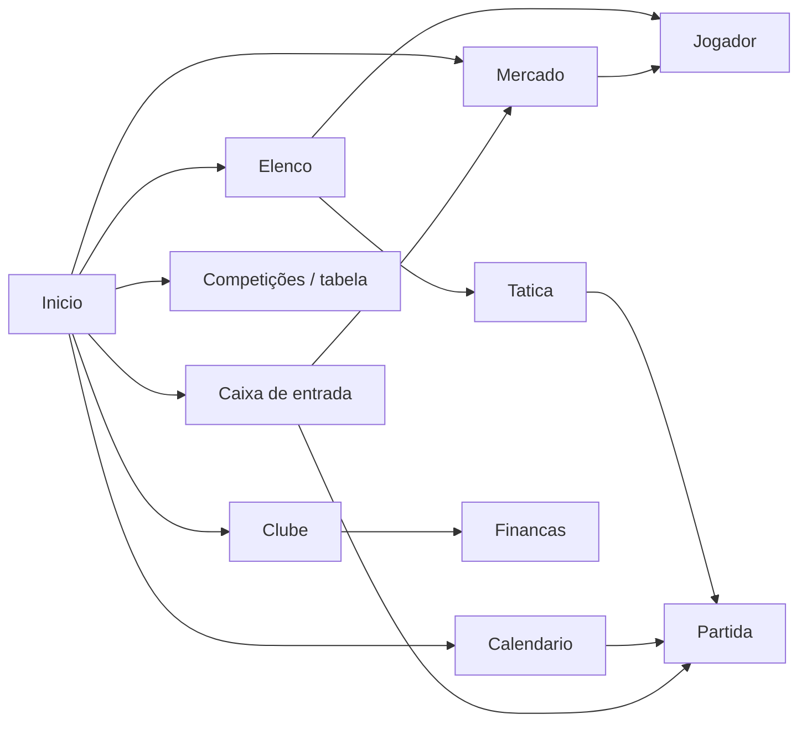

# C12 — Telas e navegação

## Objetivo
Organizar as dez telas centrais em uma navegação previsível, com ações primárias visíveis e estados vazios úteis.

## Regras
1. Barra lateral global: Início, Caixa de entrada, Elenco, Tática, Calendário, Competições, Mercado, Clube e Finanças.
2. Cabeçalho global mostra data, próximo jogo, saldo, notificações e botão Continuar.
3. Jogador, clube e competição abrem em painel contextual sem perder a lista anterior; voltar restaura filtros e rolagem.
4. Ação primária fica no canto superior direito; no máximo uma primária e três secundárias por tela.
5. Filtros persistem por save; qualquer lista grande tem busca, ordenação e exportação.
6. Verde significa confirmação positiva, âmbar atenção, vermelho risco/irreversível e azul navegação — nunca apenas cor, sempre ícone/texto.
7. Teclado: `Espaço` continuar, `G` buscar, `E` elenco, `T` tática, `M` mercado, `Esc` voltar/fechar.

## Mapa de telas

## As dez telas
| tela | mostra | ações | estado vazio |
|---|---|---|---|
| Elenco | tabela, posição, condição, moral, contrato | escalar, filtrar, comparar | “Nenhum jogador no filtro”; limpar filtro |
| Jogador | resumo, atributos, forma, contrato, histórico | abordar, treinar, comparar | histórico ausente explicado |
| Tática | campo, XI, banco, funções, instruções | arrastar, salvar, testar | sugestão de formação pelo elenco |
| Partida | placar, tempo, campo 2D, eventos, estatísticas | pausar, velocidade, instrução, substituição | pré-jogo com escalações |
| Tabela | classificação, forma, vagas, regras | trocar competição/rodada | “Competição ainda não começou” |
| Calendário | mês, jogos, treinos, viagens | filtrar, abrir partida | mês sem eventos + ir ao próximo |
| Mercado | busca, lista curta, necessidades, orçamento | observar, ofertar, comparar | sugestões baseadas em carência |
| Finanças | caixa, projeção, folha, dívida, receitas | ajustar orçamento, ver parcelas | estimativas marcadas quando faltam dados |
| Caixa de entrada | decisões, notícias, prazos | responder, delegar, arquivar | resumo da semana e botão continuar |
| Clube | identidade, estádio, diretoria, estrutura, história | ver elenco, staff, rivalidades | fonte/estimativa quando campo ausente |

## Números (parâmetros)
| parâmetro | valor | por quê / fonte |
|---|---:|---|
| largura mínima desktop | 1280 px | manter três colunas úteis |
| área de clique mínima | 40 × 40 px | acessibilidade |
| ações para escalação | ≤ 3 | velocidade de uso |
| linhas por tabela | 25 padrão | leitura e desempenho |
| duração de transição | 120–180 ms | resposta sem atraso percebido |

## Exemplos / casos de teste
| entrada | resultado esperado |
|---|---|
| clicar no nome em Mercado e voltar | filtros, página e rolagem preservados |
| abrir Tática sem onze | sugestão automática, posições vazias destacadas |
| tela a 1280 × 720 | sidebar compacta; conteúdo sem rolagem horizontal essencial |
| usuário daltônico | estados distinguíveis por texto/ícone além da cor |

## Casos de borda
Nomes longos quebram em duas linhas; 200% de escala mantém ações acessíveis; dado confidencial aparece como “desconhecido”, não zero; partida ao vivo impede Continuar global.

## Liga com
Todos os sistemas visíveis; principalmente partida, mercado, economia e caixa de entrada.

## Perguntas em aberto
Testar densidade com usuários; escolher se painel contextual ocupa 40% ou 50% da tela; produzir variação para 1920 × 1080.

